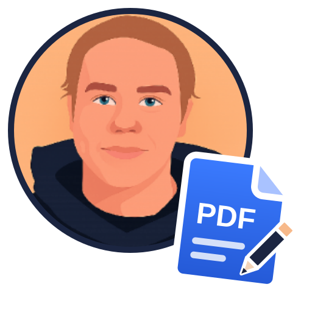

# PDF Editor

Lokálny editor PDF (napr. stiahnutých prezentácií). Beží v prehliadači, súbory nikam neodchádzajú.

## Spustenie
Dvojklik na `start.bat`. Prvý štart pripraví Python prostredie, potom sa editor otvorí na http://127.0.0.1:5173/.

## Funkcie
| Nástroj | Klávesa | Popis |
|---|---|---|
| Upraviť text | T | klik na riadok → úprava (Enter uloží, Shift+Enter nový riadok, Esc zruší). Pôvodný text sa naozaj odstráni, pozadie ostane. |
| Nový text | N | klik kamkoľvek a písanie |
| Zvýrazniť / Podčiarknuť / Prečiarknuť | H / U / S | potiahnutie cez text |
| Pero, obdĺžnik, elipsa, šípka | P / R / E / A | kreslenie (anotácie) |
| Poznámka | K | komentár na mieste kliknutia |
| Vymazať oblasť | W | natrvalo odstráni všetko v obdĺžniku |
| Výber | V | výber anotácie → Delete ju zmaže |
| **Prefarbiť** | – | zmení farbu všetkého textu na strane (alebo všetkých stranách), pôvodné písmo ostane |

Ďalej: Späť/Znova (Ctrl+Z / Ctrl+Y), uloženie (Ctrl+S), zoom (Ctrl+koliesko), otáčanie, presúvanie, duplikovanie, mazanie a vkladanie strán, pripojenie ďalšieho PDF.

**Viac dokumentov naraz:** v dialógu „Otvoriť“ označ viac súborov (alebo ich pretiahni myšou). Každý dostane vlastnú záložku s vlastnou históriou Späť/Znova. Prepínanie: klik na záložku alebo Alt+1…9. Zatvorenie: × alebo stredné tlačidlo myši. Oranžová bodka = neuložené zmeny. Záložky prežijú obnovenie stránky (F5), nie však reštart servera.

## Pre vývojárov
Pozri [CLAUDE.md](CLAUDE.md) a priečinok [docs/](docs/): [architektúra](docs/architektura.md), [API](docs/api.md), [úprava textu a prefarbenie](docs/uprava-textu.md).

## Obmedzenia
- Upravený text sa píše systémovým fontom najbližším pôvodnému (Calibri, Arial, Times…), keďže PDF často obsahuje iba orezaný font.
- Úpravy sú po riadkoch; dlhší text sa automaticky nezalamuje.
- Skenované PDF (text ako obrázok) sa takto upravovať nedá.
- Zvýraznenie sa na tmavom pozadí kreslí tmavšie (štandardné správanie PDF zvýraznenia).
